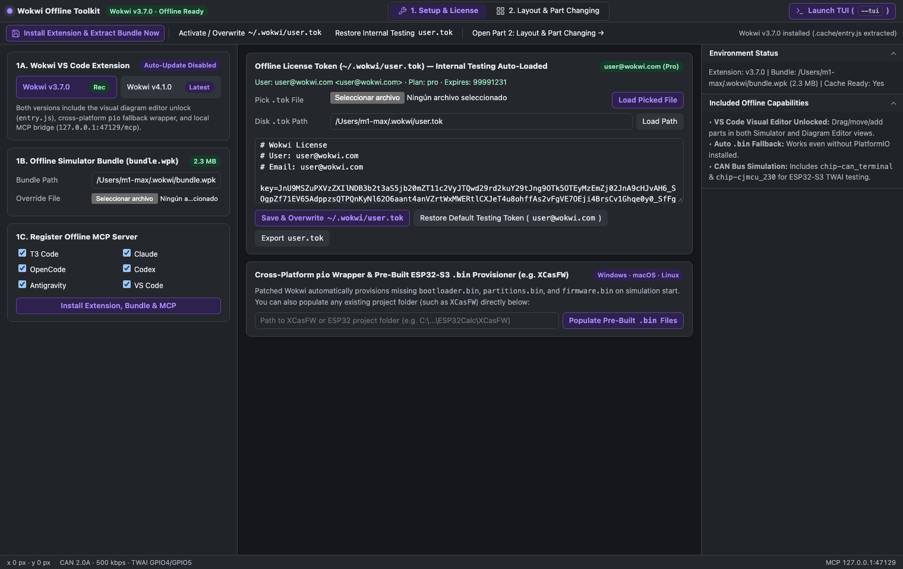
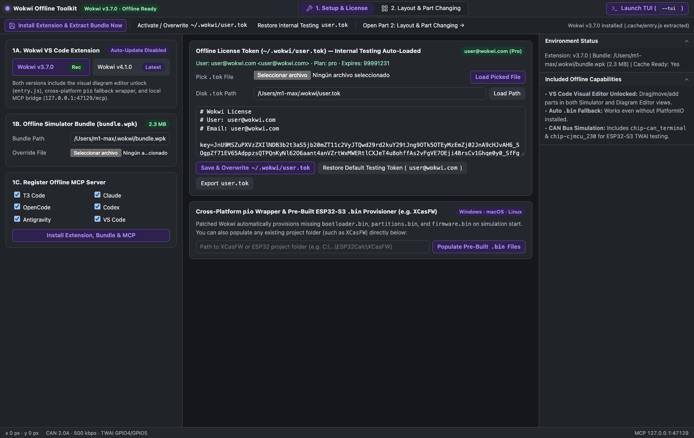
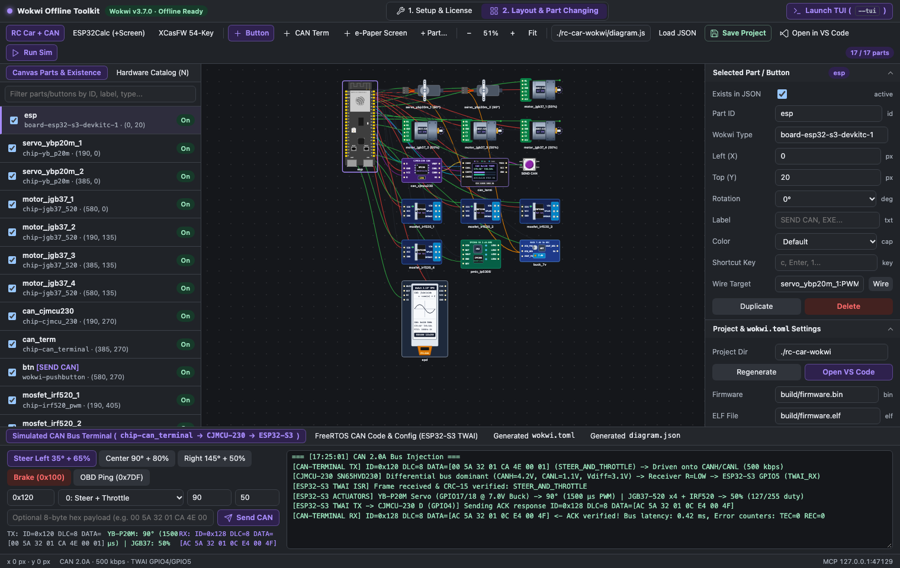
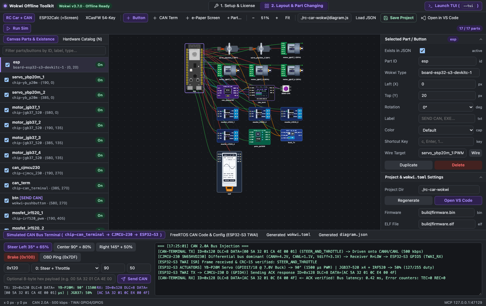

# Wokwi Offline Suite — 3-Step Guided Setup & Hardware TOML Generator

This repository contains the complete offline Wokwi setup tool, dual-version patched VS Code extension (`v3.7.0` and `v4.1.0`), pre-bundled internal testing offline simulator bundle (`files/bundle.wpk`) & license (`files/user.tok`), local MCP server (`127.0.0.1:47129/mcp`), custom WebAssembly hardware chips, and the multi-mode (**GUI**, **TUI**, and **CLI**) `wokwi.toml` + `diagram.json` generator for **Windows**, **macOS**, and **Linux** (`x86_64` & `ARM64`).

---

## Guided 3-Step GUI Workflow Screenshots

### Step 1: Install Wokwi Extension (`v3.7.0` / `v4.1.0`) & Auto-Load Offline Bundle (`bundle.wpk`)
First installs the patched Wokwi VS Code extension, disables extension auto-updates, and automatically loads/extracts the bundled internal testing `bundle.wpk` (`files/bundle.wpk` -> `~/.wokwi/bundle.wpk`, or lets you pick another `.wpk` file):



### Step 2: Auto-Loaded Internal Testing License (`user.tok`) — Or Pick Another If Wanted
Automatically fetches and activates the internal testing license (`user@wokwi.com`, Plan: `pro`, Expires: `99991231`) into `~/.wokwi/user.tok`, and lets you optionally pick or overwrite with another `.tok` file without any LLM:



### Step 3: Choose Hardware Elements (`N` of Each) & Generate `wokwi.toml` + `diagram.json`
Choose what components to add to `wokwi.toml` and `diagram.json` (with presets for the RC Car + CAN Terminal or ESP32 Calculator, custom $N$ quantities, live electrical/power rail calculations, and custom `.chip.wasm` / `.chip.json` importing):



### Step 4: Visual Layout & Button Manager + Simulated CAN Bus Terminal (`chip-can_terminal`)
Visually drag and move any button (`wokwi-pushbutton`) or hardware part (`left`, `top`), toggle whether a button/part **exists** in `diagram.json`, add new buttons or chips, load the 54-button `XCasFW` layout or the `RC Car + CAN` layout, and test sending CAN 2.0A frames from the **Simulated CAN Bus Terminal** (`can_term`) through the `CJMCU-230` transceiver to the `ESP32-S3` TWAI controller:



---

## 1. Executables & Supported Modes (GUI, TUI, CLI)

| Platform | Executable / Launcher | Description |
| :--- | :--- | :--- |
| **Windows (x86_64)** | `WokwiOfflineToolkit.exe` / `install.bat` | Standalone native 64-bit Windows executable |
| **macOS (ARM64)** | `./wokwi-offline-toolkit-macos` / `./install.sh` | Standalone native Apple Silicon executable & shell launcher |
| **Linux (x86_64)** | `./wokwi-offline-toolkit-linux-amd64` / `./install.sh` | Standalone native 64-bit Linux (`amd64`) executable & shell launcher |
| **Linux (ARM64)** | `./wokwi-offline-toolkit-linux-arm64` / `./install.sh` | Standalone native ARM64 Linux (`aarch64`) executable & shell launcher |

> **Tip**: On both **macOS** and **Linux**, `./install.sh` automatically detects your operating system (`Darwin` vs `Linux`) and CPU architecture (`x86_64` vs `arm64`/`aarch64`) and launches the corresponding native binary.

### Launch Modes

1. **GUI Mode (Default when launched without arguments or with `--gui`)**:
   ```bash
   # macOS or Linux (auto-detects OS & CPU architecture)
   ./install.sh --gui

   # Or run the platform binary directly:
   ./wokwi-offline-toolkit-macos --gui          # macOS (ARM64)
   ./wokwi-offline-toolkit-linux-amd64 --gui    # Linux (x86_64)
   ./wokwi-offline-toolkit-linux-arm64 --gui    # Linux (ARM64)

   # Windows
   WokwiOfflineToolkit.exe --gui
   # or double-click WokwiOfflineToolkit.exe / install.bat
   ```
   Opens the **3-Step Guided Wizard GUI** at `http://127.0.0.1:47130`:
   - **Step 1**: First choose & install Wokwi `v3.7.0` (Recommended) or `v4.1.0`, auto-extract `files/bundle.wpk` (or pick a custom `.wpk` file), and optionally register the MCP server.
   - **Step 2**: Automatically loads the bundled internal testing `user.tok` (`user@wokwi.com`, Plan `pro`, Expires `99991231`), or lets you pick/overwrite with another `.tok` file (no LLM required).
   - **Step 3**: Choose what hardware elements ($N$ of each) to add to `wokwi.toml` and `diagram.json`, import custom chips, and write everything to your project folder.

2. **TUI Mode (`--tui` — Interactive Guided Terminal UI)**:
   ```bash
   # macOS / Linux
   ./install.sh --tui

   # Windows
   WokwiOfflineSetup.exe --tui
   ```
   Walks you through the same **Step 1 (Install Extension & Bundle) → Step 2 (Load `user.tok`) → Step 3 (Choose Hardware & Generate `wokwi.toml`)** workflow directly in the terminal.

3. **CLI Mode (`--cli` — Flag-Driven Automation)**:
   ```bash
   # Run full offline setup (auto-uses bundled files/bundle.wpk and files/user.tok if omitted):
   ./install.sh --cli --ext-version 3.7.0 --mcp "t3 anthropic opencode"

   # Generate an RC Car project with custom N counts:
   ./install.sh --cli \
     --preset rc-car \
     --counts "esp32_s3_n16r8=1,yb_p20m=2,jgb37_520=4,cjmcu_230=1,irf520_pwm=4,ip5306=1,reg_7v=1" \
     --out ./my-rc-car

   # Load & overwrite ~/.wokwi/user.tok manually via CLI (no LLM needed):
   ./install.sh --cli --load-user-tok /path/to/my-user.tok
   # Windows:
   WokwiOfflineSetup.exe --cli --load-user-tok C:\path\to\my-user.tok

   # Populate pre-built ESP32-S3 / XCasFW .bin files & cross-platform pio scripts into an existing project (no PIO needed):
   ./install.sh --cli --fix-project /path/to/ESP32Calc/XCasFW
   WokwiOfflineSetup.exe --cli --fix-project C:\path\to\ESP32Calc\XCasFW
   ```

---

## 2. Automatic `pio` Wrapper & Missing `.bin` Circumvention (Windows, macOS, Linux)

For projects like **`XCasFW` (`ESP32Calc`)** or newly generated ESP32-S3 projects where PlatformIO (`pio`) is not installed or fails to build `.bin` files (such as Windows `MAX_PATH` / linker errors or missing `.pio/build/esp32-s3-wokwi/*.bin`):

1. **Zero-Config Extension Auto-Fallback (`extension-3.7.0` & `extension-4.1.0`)**:
   - Whenever Wokwi starts a simulation and a `.bin` file or `flasher_args.json` (`.pio/build/esp32-s3-wokwi/bootloader.bin`, `partitions.bin`, `firmware.bin`, or `build/firmware.bin`) is missing in the workspace, the patched extension **automatically provisions it from `~/.wokwi/firmware-fallbacks/`**, writes it into the expected workspace path, and boots the simulator immediately without throwing a `.bin` error.
   - If `wokwi.toml` points directly to an unmerged app `.bin` (`build/firmware.bin`), the extension automatically pairs it with `bootloader.bin` (`0x0`) and `partitions.bin` (`0x8000`) as `flashSections`.
2. **Cross-Platform `pio` / `platformio` Wrapper (`~/.wokwi/bin/pio` & `pio.cmd`)**:
   - Added automatically to VS Code's integrated terminal `PATH` on **Windows, macOS, and Linux**.
   - Runs real PlatformIO (`~/.platformio/penv/...`) if installed; if `pio` is not installed or exits with a build error, it automatically provisions the pre-built `.bin` files so `build_wokwi.sh` / `build_wokwi.bat` and Wokwi Simulation always succeed.
3. **One-Click GUI & CLI Project Fixer (`--fix-project`)**:
   - In **Step 1** of the GUI (or via `--fix-project <path>`), you can also pre-populate any existing project folder (`XCasFW`, `ESP32Calc`, or custom firmware) with `.pio/build/esp32-s3-wokwi/{bootloader.bin,partitions.bin,firmware.bin}`, `build/*.bin`, `flasher_args.json`, `build_wokwi.sh`, and `build_wokwi.bat`.

---

## 3. Dual Extension Version Support (`v3.7.0` & `v4.1.0`) & Offline Architecture

Both **`extension-3.7.0`** (`wokwi.wokwi-vscode-3.7.0`, also archived in `vsix/Wokwi.wokwi-vscode-3.7.0.vsix`) and **`extension-4.1.0`** (`wokwi.wokwi-vscode-4.1.0`) are bundled and patched with identical offline guarantees:

1. **Automatic `.wpk` Extraction (`UpdateService.init`)**:
   - Both `3.7.0` and `4.1.0` use the `v=1;t=vsc1` + `0x42` XOR-encoded `.tar.gz` format for `~/.wokwi/bundle.wpk`.
   - On extension activation, `UpdateService.init()` automatically extracts `~/.wokwi/bundle.wpk` into `.cache/` (`entry.js`, `index.html`, `index.json`, WASM binaries) and sets `_bundleReady = true`.
   - `UpdateService.update()` immediately returns when `_bundleReady` is true so `wokwi.com` never overwrites your local `.cache/` or invalidates your token.
2. **Unconditional Offline Simulator Webview (`WokwiWebview.getHTML` & `media/main.js`)**:
   - Whenever `UpdateService.instance.bundleReady` is `true`, `WokwiWebview.getHTML()` unconditionally returns `getOfflineHTML(e)` instead of loading the online `https://wokwi.com/vscode/wcode` `<iframe>`.
   - This guarantees the simulator always runs `.cache/entry.js` (which verifies `user.tok` against your offline bundle's embedded RSA public key rather than Wokwi's online server key).
3. **Instant `user.tok` Caching (`LicenseService.read`)**:
   - `LicenseService.read()` directly reads, caches, and returns `~/.wokwi/user.tok` on first read so the token is immediately passed into the offline simulator webview on first launch.
4. **Embedded HTTP MCP Bridge (`127.0.0.1:47129/mcp`)**:
   - Backported into both `3.7.0` and `4.1.0` so all 21 MCP tools work identically on either version.

5. **Unlocked Visual Diagram & Button Editor Inside VS Code (`.cache/entry.js` & `bundle.wpk`)**:
   - Patched `mC1()`, `Uke()`, `hC1()`, and `vke` (`disableEdit: false`) inside `entry.js` (`files/bundle.wpk`) and `WokwiSession.processMessage("diagramChange")` in `extension.js`.
   - In **both** Wokwi Simulator mode (when stopped or by clicking the **`✏️ Stop Sim to Move / Add Parts`** button in the top toolbar) and `diagram.json` Diagram Editor mode, the purple **`+` ("Add a new part")** button and drag-and-drop moving/rotating/deleting are permanently unlocked and automatically persist changes to `diagram.json`.

---

## 4. Bundled Hardware Elements (`tabla_piezas_voltajes_amperajes.pdf` + Simulated CAN Terminal)

All elements below are pre-compiled into WebAssembly custom chips (`.chip.wasm` + `.chip.json` + `.chip.c` in `hardware/`) and registered in `hardware/catalog.json`:

1. **YB-P20M High-Torque Digital Servo (`chip-yb_p20m`)**:
   - **Operating Voltage**: `6.0 – 7.4 V` | **Current-per-Torque Ratio**: `1.317 A / (N·m)` | **Stall Current**: `≤ 3.6 A` | **Torque**: `2.7 N·m @ 7.4 V`
   - **Pins**: `["PWM", "VCC", "GND", "FB"]`
2. **JGB37-520 Geared DC Motor + Encoder (`chip-jgb37_520`)**:
   - **12 V Mode**: `120 mA` no-load, `400 mA` (`400` in sheet) load/stall | **24 V Mode**: `50 mA` no-load, `200 mA` (`200` in sheet) load/stall
   - **Pins**: `["M1", "M2", "GND", "C1", "C2", "VCC"]`
3. **ESP32-S3 N16R8 (`board-esp32-s3-devkitc-1`, 16MB Flash / 8MB PSRAM)**:
   - **VDD33**: `3.0 – 3.6 V` (Typ `3.3 V`), external supply `≥ 0.5 A` | **Cumulative IO Output Current**: `1500 mA` max (`-40 to 105 °C`)
4. **CJMCU-230 SN65HVD230 CAN Bus Transceiver (`chip-cjmcu_230`)**:
   - **Vcc**: `-0.3 V to 6 V` (Typ `3.3 V`) | **CANH / CANL Voltage**: `-4 V to 6 V` | **IO Current**: `±11 mA`
   - **Pins**: `["D", "GND", "VCC", "R", "VREF", "CANL", "CANH", "RS"]` (wired to ESP32-S3 TWAI `GPIO4` TX -> `D` and `GPIO5` RX <- `R`)
5. **Simulated CAN Bus Terminal & Frame Injector (`chip-can_terminal`)**:
   - **Live 128×48 Framebuffer Display & Interactive Controls**: `canId` (default `0x120`), `cmdType` (`0`=Steer+Throttle, `1`=Steer, `2`=Emergency Brake, `3`=Ping), `steeringDeg` (`0–180°`), `throttlePct` (`0–100%`), `sendSeq` (manual trigger), and `autoPeriodic` (2s heartbeat).
   - **Pins**: `["CANH", "CANL", "CANTX", "CANRX", "TRIG", "VCC", "GND"]` — wired to `cjmcu_230` (`CANH`/`CANL`), `esp32_s3_n16r8` (`GPIO5`/`GPIO4`), and a trigger pushbutton (`wokwi-pushbutton` on `TRIG`) to test sending CAN messages and verifying the ESP32-S3's response.
6. **IRF520 PWM MOSFET Driver Module (`chip-irf520_pwm`)**:
   - **$V_{DS}$**: `100 V` max | **$V_{GS}$**: `±20 V` | **Continuous $I_D$**: `9.2 A` ($25^\circ\text{C}$) / `6.5 A` ($100^\circ\text{C}$) | **Pulsed $I_{DM}$**: `37 A` | **$P_D$**: `60 W`
   - **Pins**: `["SIG", "VCC", "GND", "VIN", "VPLUS", "VMINUS"]`
7. **IP5306 Power Bank & Li-Ion PMIC (`chip-ip5306`)**:
   - **Port Input Voltage ($V_{IN}$)**: `-0.3 V to 5.5 V` | **Operating Temp**: `0 ~ 70 °C` | **$R_{\theta JA}$**: `50 °C/W` | **ESD HBM**: `4 kV`
   - **Pins**: `["VIN", "BAT", "VOUT", "GND", "KEY", "LED1", "LED2", "LED3", "LED4"]`
8. **7V Buck Voltage Regulator (`chip-reg_7v`)**:
   - **Wiring Answer (PDF Section 7)**: Input is **12–24 V** (from the main motor battery rail) and output is regulated **7.0 V** (`VOUT_POS`) to power the **YB-P20M servos** (`6–7.4 V`). Connect the servos' `PWM` and `FB` signal lines to the **ESP32-S3** (`3.3 V` GPIO) with a **shared common `GND`**.
   - **Pins**: `["VIN_POS", "VIN_NEG", "VOUT_POS", "VOUT_NEG", "EN"]`
9. **Optional Elements**: `Tactile Pushbutton (wokwi-pushbutton)`, `ESP32-S3 N16R16`, `WeAct 2.13" B/W e-Paper Display (weact_213_bw)`, and `MicroSD Card (wokwi-microsd-card)`.
