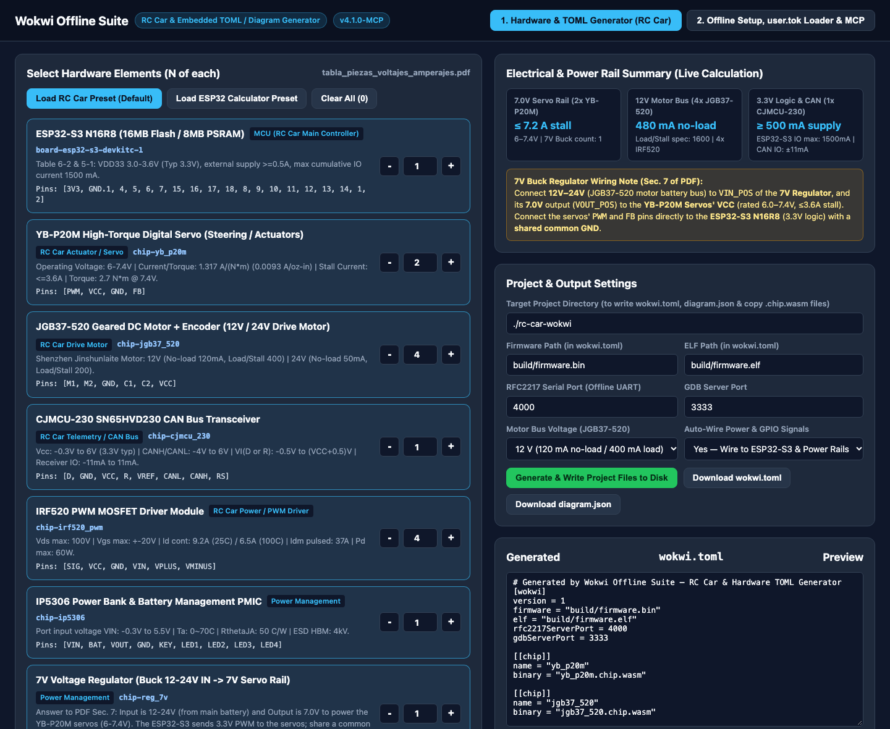
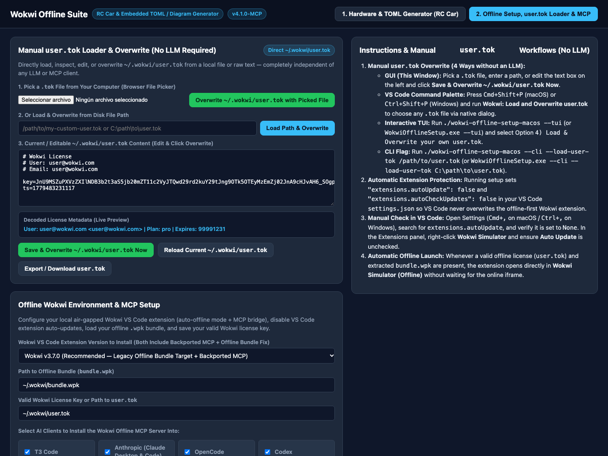

# Wokwi Offline Suite — RC Car & Embedded Hardware Setup + TOML Generator

This repository contains the complete offline Wokwi setup tool, dual-version patched VS Code extension (`v3.7.0` and `v4.1.0`), local MCP server (`127.0.0.1:47129/mcp`), custom WebAssembly hardware chips, and the multi-mode (**GUI**, **TUI**, and **CLI**) `wokwi.toml` + `diagram.json` generator for **Windows**, **macOS**, and **Linux** (`x86_64` & `ARM64`).

---

## Screenshots

### 1. Hardware & TOML Generator (`N` Selector + Custom Chip Importer)


### 2. Offline Environment Setup (`v3.7.0` / `v4.1.0`), Manual `user.tok` Loader & MCP Registration


---

## 1. Executables & Supported Modes (GUI, TUI, CLI)

| Platform | Executable / Launcher | Description |
| :--- | :--- | :--- |
| **Windows (x86_64)** | `WokwiOfflineSetup.exe` / `install.bat` | Standalone native 64-bit Windows executable |
| **macOS (ARM64)** | `./wokwi-offline-setup-macos` / `./install.sh` | Standalone native Apple Silicon executable & shell launcher |
| **Linux (x86_64)** | `./wokwi-offline-setup-linux-amd64` / `./install.sh` | Standalone native 64-bit Linux (`amd64`) executable & shell launcher |
| **Linux (ARM64)** | `./wokwi-offline-setup-linux-arm64` / `./install.sh` | Standalone native ARM64 Linux (`aarch64`) executable & shell launcher |

> **Tip**: On both **macOS** and **Linux**, `./install.sh` automatically detects your operating system (`Darwin` vs `Linux`) and CPU architecture (`x86_64` vs `arm64`/`aarch64`) and launches the corresponding native binary.

### Launch Modes

1. **GUI Mode (Default when launched without arguments or with `--gui`)**:
   ```bash
   # macOS or Linux (auto-detects OS & CPU architecture)
   ./install.sh --gui

   # Or run the platform binary directly:
   ./wokwi-offline-setup-macos --gui          # macOS (ARM64)
   ./wokwi-offline-setup-linux-amd64 --gui    # Linux (x86_64)
   ./wokwi-offline-setup-linux-arm64 --gui    # Linux (ARM64)

   # Windows
   WokwiOfflineSetup.exe --gui
   # or double-click WokwiOfflineSetup.exe / install.bat
   ```
   Opens the interactive **Hardware & TOML Generator + Offline Setup GUI** at `http://127.0.0.1:47130`, where you can:
   - Choose the **RC Car Preset (Default)**, **ESP32 Calculator Preset**, or **Custom** counts.
   - Set quantity **$N$** of each component (`0, 1, 2, 3, 4...`) with live power-rail calculations (`7.0V Servo Buck Rail`, `12V/24V Motor Bus`, `5.0V IP5306 Rail`, `3.3V ESP32-S3 Logic Rail`).
   - **Import Other / Custom Elements** (`.chip.json`, `.chip.wasm`, `.chip.c`, or custom Wokwi parts).
   - Preview and write `wokwi.toml`, `diagram.json`, and all required `.chip.wasm` + `.chip.json` files directly to any project folder.
   - Choose between **Wokwi `v3.7.0` (Recommended for Custom `.wpk` & `user.tok`)** and **Wokwi `v4.1.0`**, extract `bundle.wpk`, load/overwrite `user.tok` manually without an LLM, and register the MCP server in T3 Code, Anthropic, OpenCode, Codex, Antigravity, VS Code, Cursor, and Zed.

2. **TUI Mode (`--tui` — Interactive Terminal UI)**:
   ```bash
   # macOS / Linux (via auto-detect wrapper or direct binary)
   ./install.sh --tui
   ./wokwi-offline-setup-macos --tui
   ./wokwi-offline-setup-linux-amd64 --tui
   ./wokwi-offline-setup-linux-arm64 --tui

   # Windows
   WokwiOfflineSetup.exe --tui
   ```
   Walks you interactively in the terminal through:
   - Choosing Wokwi extension version (`3.7.0` or `4.1.0`)
   - Full Offline Environment Setup (`.wpk` bundle, valid license key, MCP client installation)
   - Manual `user.tok` load & overwrite (no LLM required)
   - Picking a preset (`rc-car`, `esp32calc`, `zero`), setting $N$ of each component, importing custom chips, and generating `wokwi.toml` + `diagram.json`.

3. **CLI Mode (`--cli` — Flag-Driven Automation)**:
   ```bash
   # Generate an RC Car project with custom N counts (macOS / Linux / Windows):
   ./install.sh --cli \
     --preset rc-car \
     --counts "esp32_s3_n16r8=1,yb_p20m=2,jgb37_520=4,cjmcu_230=1,irf520_pwm=4,ip5306=1,reg_7v=1" \
     --out ./my-rc-car

   # Run full offline setup (choosing v3.7.0 or v4.1.0) + MCP registration via CLI:
   ./install.sh --cli \
     --ext-version 3.7.0 \
     --bundle ~/.wokwi/bundle.wpk \
     --license ~/.wokwi/user.tok \
     --mcp "t3 anthropic opencode"

   # Load & overwrite ~/.wokwi/user.tok manually via CLI (no LLM needed):
   ./install.sh --cli --load-user-tok /path/to/my-user.tok
   # Windows:
   WokwiOfflineSetup.exe --cli --load-user-tok C:\path\to\my-user.tok
   ```

---

## 2. Dual Extension Version Support (`v3.7.0` & `v4.1.0`) & Offline Architecture

Both **`extension-3.7.0`** (`wokwi.wokwi-vscode-3.7.0`, also archived in `vsix/Wokwi.wokwi-vscode-3.7.0.vsix`) and **`extension-4.1.0`** (`wokwi.wokwi-vscode-4.1.0`) are bundled and patched with identical offline guarantees:

1. **Automatic `.wpk` Extraction (`UpdateService.init`)**:
   - Both `3.7.0` and `4.1.0` use the `v=1;t=vsc1` + `0x42` XOR-encoded `.tar.gz` format for `~/.wokwi/bundle.wpk`.
   - On extension activation, `UpdateService.init()` automatically extracts `~/.wokwi/bundle.wpk` into `.cache/` (`entry.js`, `index.html`, `index.json`, WASM binaries) and sets `_bundleReady = true`.
   - `UpdateService.update()` immediately returns when `_bundleReady` is true so `wokwi.com` never overwrites your local `.cache/` or invalidates your token.
2. **Unconditional Offline Simulator Webview (`WokwiWebview.getHTML` & `media/main.js`)**:
   - Whenever `UpdateService.instance.bundleReady` is `true`, `WokwiWebview.getHTML()` unconditionally returns `getOfflineHTML(e)` instead of loading the online `https://wokwi.com/vscode/wcode` `<iframe>`.
   - This guarantees the simulator always runs `.cache/entry.js` (which verifies `user.tok` against your offline bundle's embedded RSA public key rather than Wokwi's online server key).
3. **Instant `user.tok` Caching (`LicenseService.read`)**:
   - `LicenseService.read()` directly reads, caches, and returns `~/.wokwi/user.tok` on first read so the token is immediately passed into the offline simulator webview on first launch.
4. **Embedded HTTP MCP Bridge (`127.0.0.1:47129/mcp`)**:
   - Backported into both `3.7.0` and `4.1.0` so all 21 MCP tools work identically on either version.

---

## 3. Loading & Overwriting Your Own `user.tok` (Manual & MCP)

You can load and overwrite `~/.wokwi/user.tok` **manually without any LLM** in 4 ways (all automatically back up any existing file to `~/.wokwi/user.tok.bak` and hot-reload the running VS Code extension if open):

1. **Standalone GUI (`--gui`)**:
   Open Tab 2 (**2. Offline Setup, user.tok Loader & MCP**) -> **Manual `user.tok` Loader & Overwrite (No LLM Required)**:
   - Use the **Browser File Picker** (`Pick a .tok File from Your Computer`) and click **Overwrite `~/.wokwi/user.tok` with Picked File**, OR
   - Enter any disk path (`/path/to/user.tok` or `C:\path\to\user.tok`) and click **Load Path & Overwrite**, OR
   - View/edit the raw `key=...` / `ts=...` content directly in the live text editor (with real-time decoded User, Email, Plan, and Expiration preview) and click **Save & Overwrite `~/.wokwi/user.tok` Now**.
2. **VS Code Command Palette (No LLM)**:
   Press `Cmd+Shift+P` (macOS) or `Ctrl+Shift+P` (Windows/Linux) in VS Code and run:
   - **`Wokwi: Load and Overwrite user.tok`** (opens a native OS file picker to select any `.tok` file and immediately overwrites `~/.wokwi/user.tok` + reloads `LicenseService` in memory).
3. **Interactive TUI (`--tui`)**:
   Run `./install.sh --tui` (or `WokwiOfflineSetup.exe --tui`) and choose **Option `4) Load & Overwrite your own user.tok (Manual, no LLM required)`**.
4. **CLI (`--load-user-tok` / `--overwrite-user-tok`)**:
   ```bash
   ./install.sh --cli --load-user-tok /path/to/custom-user.tok
   ```
5. **Via MCP Tool (`wokwi_load_user_tok`)**:
   Also exposed as an MCP tool (`filePath` or `content`) for AI clients when desired.

---

## 4. Bundled Hardware Elements (`tabla_piezas_voltajes_amperajes.pdf`)

All elements below are pre-compiled into WebAssembly custom chips (`.chip.wasm` + `.chip.json` + `.chip.c` in `hardware/`) using `wasi-sdk` and registered in `hardware/catalog.json`:

1. **YB-P20M High-Torque Digital Servo (`chip-yb_p20m`)**:
   - **Operating Voltage**: `6.0 – 7.4 V`
   - **Current-per-Torque Ratio**: `1.317 A / (N·m)` (`0.0093 A/oz-in`)
   - **Stall Current (Max)**: `≤ 3.6 A`
   - **Torque**: `2.7 N·m @ 7.4 V`
   - **Pins**: `["PWM", "VCC", "GND", "FB"]`
2. **JGB37-520 Geared DC Motor + Encoder (`chip-jgb37_520`)**:
   - **12 V Mode**: `120 mA` no-load, `400 mA` (`400` in sheet) load/stall
   - **24 V Mode**: `50 mA` no-load, `200 mA` (`200` in sheet) load/stall
   - **Pins**: `["M1", "M2", "GND", "C1", "C2", "VCC"]`
3. **ESP32-S3 N16R8 (`board-esp32-s3-devkitc-1`, 16MB Flash / 8MB PSRAM)**:
   - **VDD33**: `3.0 – 3.6 V` (Typ `3.3 V`), external supply `≥ 0.5 A`
   - **Cumulative IO Output Current**: `1500 mA` max (`-40 to 105 °C`)
4. **CJMCU-230 SN65HVD230 CAN Bus Transceiver (`chip-cjmcu_230`)**:
   - **Vcc**: `-0.3 V to 6 V` (Typ `3.3 V`)
   - **CANH / CANL Voltage**: `-4 V to 6 V`
   - **Digital Input/Output Voltage VI (D or R)**: `-0.5 V to (VCC + 0.5) V`
   - **Receiver Output Current IO**: `-11 mA to +11 mA`
   - **Pins**: `["D", "GND", "VCC", "R", "VREF", "CANL", "CANH", "RS"]`
5. **IRF520 PWM MOSFET Driver Module (`chip-irf520_pwm`)**:
   - **Drain-Source Voltage ($V_{DS}$)**: `100 V` max | **Gate-Source Voltage ($V_{GS}$)**: `±20 V`
   - **Continuous Drain Current ($I_D$)**: `9.2 A` ($T_C=25^\circ\text{C}$) / `6.5 A` ($T_C=100^\circ\text{C}$) | **Pulsed ($I_{DM}$)**: `37 A` | **$P_D$**: `60 W`
   - **Pins**: `["SIG", "VCC", "GND", "VIN", "VPLUS", "VMINUS"]`
6. **IP5306 Power Bank & Li-Ion PMIC (`chip-ip5306`)**:
   - **Port Input Voltage ($V_{IN}$)**: `-0.3 V to 5.5 V` | **Operating Temp**: `0 ~ 70 °C` | **$R_{\theta JA}$**: `50 °C/W` | **ESD HBM**: `4 kV`
   - **Pins**: `["VIN", "BAT", "VOUT", "GND", "KEY", "LED1", "LED2", "LED3", "LED4"]`
7. **7V Buck Voltage Regulator (`chip-reg_7v`)**:
   - **Wiring Answer (PDF Section 7)**: Input is **12–24 V** (from the main motor battery rail) and output is regulated **7.0 V** (`VOUT_POS`) to power the **YB-P20M servos** (`6–7.4 V`). Connect the servos' `PWM` and `FB` signal lines to the **ESP32-S3** (`3.3 V` GPIO) with a **shared common `GND`**.
   - **Pins**: `["VIN_POS", "VIN_NEG", "VOUT_POS", "VOUT_NEG", "EN"]`
8. **Optional Elements**: `ESP32-S3 N16R16`, `WeAct 2.13" B/W e-Paper Display (weact_213_bw)`, and `MicroSD Card (wokwi-microsd-card)`.

---

## 5. Disabling VS Code Extension Auto-Updates

1. **Automatic (Done by Setup)**:
   Running setup automatically writes `"extensions.autoUpdate": false` and `"extensions.autoCheckUpdates": false` into your VS Code `settings.json`:
   - **macOS**: `~/Library/Application Support/Code/User/settings.json`
   - **Linux**: `~/.config/Code/User/settings.json`
   - **Windows**: `%APPDATA%\Code\User\settings.json`
2. **Manual Verification in VS Code**:
   - Open Settings (`Cmd+,` on macOS / `Ctrl+,` on Windows & Linux).
   - Search for `extensions.autoUpdate` and set **Extensions: Auto Update** to **`None`**.
   - Uncheck **Extensions: Auto Check Updates**.
   - In the Extensions sidebar (`Cmd+Shift+X` / `Ctrl+Shift+X`), right-click **Wokwi Simulator** and ensure **Auto Update** is **unchecked**.
